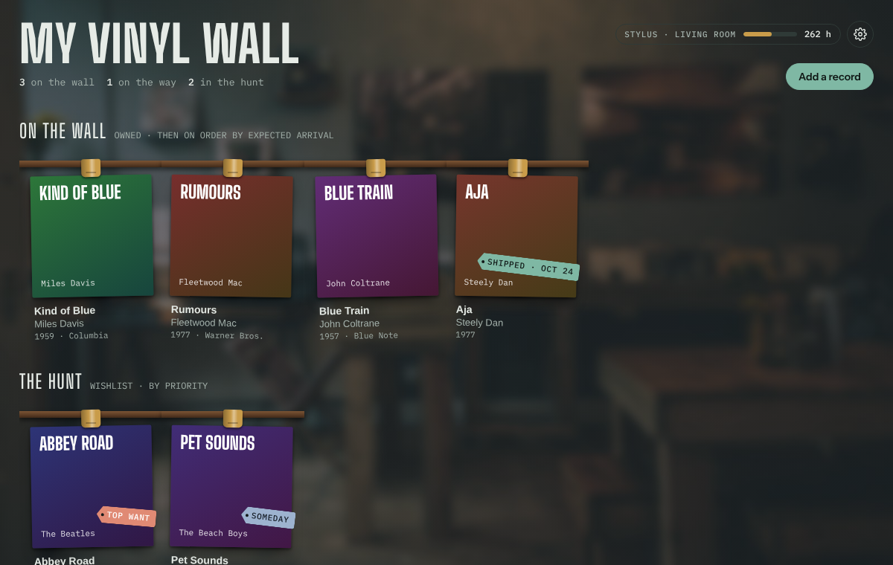
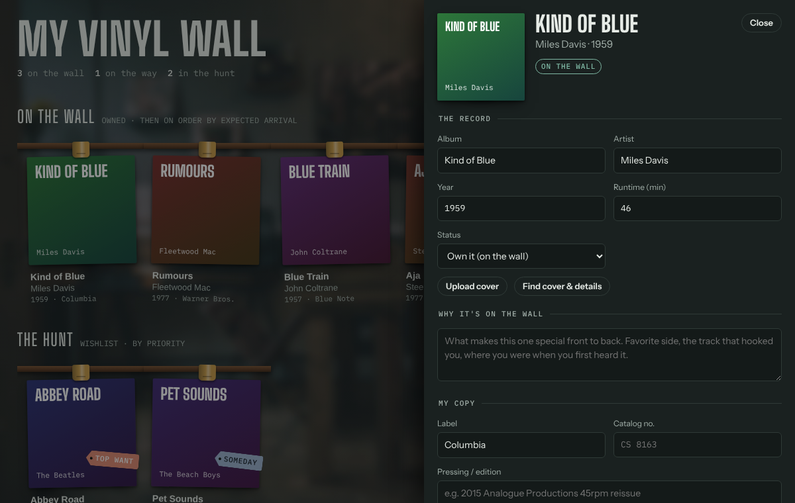
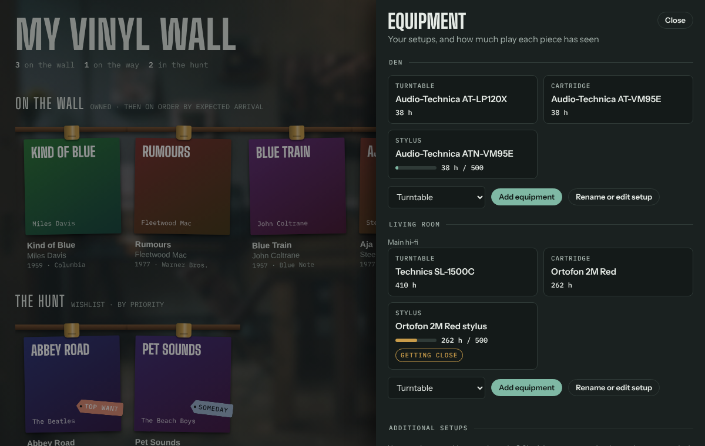
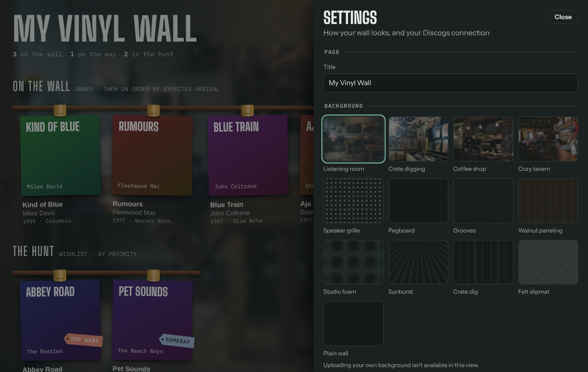
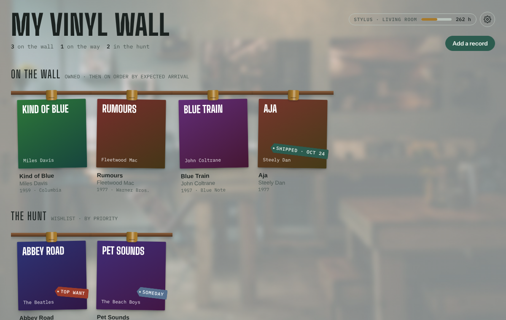

# Vinyl Wall

A record wall for your vinyl collection, built to run in [Claude](https://claude.ai).

Your records hang on a rack with their real album covers. Keep a wishlist of the ones you're hunting, track orders on the way, write notes and a listening log for each album, and log wear on your turntable, cartridge and stylus. Optionally, keep it all in sync with your Discogs collection and wantlist.

## Set it up

Paste this into a new Claude conversation:

> Set up a Vinyl Wall for me by following the instructions at https://raw.githubusercontent.com/ober37/vinyl-wall/v0.1.0/SETUP.md

Claude publishes the wall as your own private page, creates the background task that finds covers and syncs Discogs, and walks you through the rest. It takes a few minutes. Your records, notes and settings belong to your account only; nothing is shared with this project.

To update later, ask Claude: *"Update my Vinyl Wall using https://raw.githubusercontent.com/ober37/vinyl-wall/v0.1.0/SETUP.md"* (with the newer version number).

### What your Claude setup needs

- Published pages (artifacts) with saved data and runtime capabilities
- Scheduled tasks (the wall starts its background task on demand; it doesn't run on a timer)
- Code execution with web access to `raw.githubusercontent.com`, Deezer, iTunes, MusicBrainz and Discogs

If something's missing, Claude tells you before building anything.

## Features

- **The wall.** Owned records hang on walnut rails with brass clips; orders on the way hang behind them, sorted by expected arrival. Hover (or tap) a sleeve to open it.
- **The hunt.** A wishlist with priorities (Top want, Want, Someday), a budget, and a target pressing. One-click search links (Discogs, eBay, MusicStack, Popsike) and optional research from Claude on which pressings to look for.
- **Automatic details.** Add just an artist and album: the cover, year, label and runtime are looked up for you.
- **Your copy.** Media and sleeve grades, catalog number, pressing, matrix/runout, where you bought it and what you paid.
- **Orders.** Store, order number, status, expected date, carrier and tracking link. "It arrived" moves it to the wall.
- **Listening log.** Dated notes per record, plus "Played the whole album" / "Played one side".
- **Equipment.** Turntables, cartridges, styluses, speakers and more, grouped into setups (e.g. Office, Living room) with shared gear. Plays add hours to the right gear; styluses warn you as they approach their rated life.
- **Discogs sync (optional).** Owned records go to your Discogs collection with grades and notes; the hunt and orders go to your wantlist.
- **Make it yours.** Rename the wall and pick a background: softened photos of a listening room, a record shop, a coffee shop or a tavern, or patterns like speaker grille and walnut paneling. Or upload your own.
- Works on phones, and in light and dark mode.

| | |
|---|---|
|  |  |
|  |  |

## Your Discogs token

Discogs sync uses a personal access token (Discogs → Settings → Developers → Generate new token). Enter it in the wall's **Settings**, never in the chat.

- It's saved in your **private per-user space** on the page. People you share the wall with can't read it, and it isn't stored in the page, with your records, or in the background task's instructions.
- The page can save or delete it but never shows it again; only the last four characters appear.
- Only the background task reads it, passes it to the sync script through an environment variable, and deletes its temporary copy when done.
- Revoke it on Discogs at any time.

The sync only writes to *your* collection and wantlist. It never deletes collection items it didn't add, and it can't edit Discogs' shared release database (the Discogs API doesn't allow that); the record sheet has a button to copy your runout notes for a manual Discogs submission.

## What's in this repo

| Path | What it is |
|---|---|
| `app/vinyl-wall.html` | The wall itself: one self-contained page |
| `app/tools/discogs_sync.py` | One-way sync from the wall to your Discogs collection and wantlist |
| `app/backgrounds/` | The softened photo backgrounds |
| `tasks/background-task.md` | Instructions for the background task (covers, runtimes, Discogs) |
| `SETUP.md` | Step-by-step instructions Claude follows to install or update a wall |

## Credits and licenses

- **Code** (everything except the photos): [MIT](LICENSE).
- **Background photos** in `app/backgrounds/`: **non-commercial use only**. See [NOTICE.md](NOTICE.md). If you use this project commercially, replace them.
- Album information and cover art come from Deezer, iTunes and MusicBrainz / Cover Art Archive, and remain their owners' property.
- Vinyl Wall isn't affiliated with Anthropic or Discogs.
